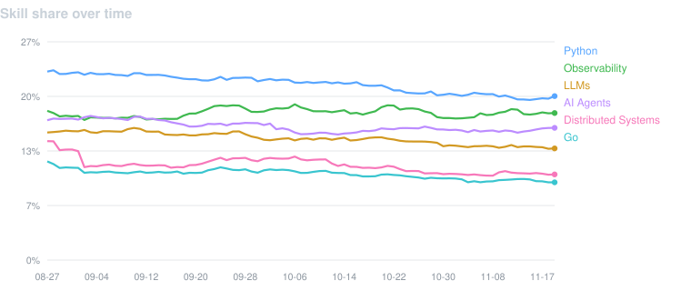

# AI Job Radar

> Daily snapshot of what AI and tech companies are hiring for in remote roles, built from public job-board APIs. Updated every morning by GitHub Actions.

**2026-11-22** — tracking **2,894 open remote roles** across **86 companies** (795 of them engineering roles). 1,712 postings disclose pay. **0 appeared today.**

<sub>Remote-only: 14,701 postings were collected across all locations and 19.7% of them were remote. Set `remote_only` to false in `config/settings.json` to track every location.</sub>

---

## Most-requested skills in remote engineering roles

Share of the 795 remote engineering postings that mention each skill.


<details><summary>Full skill table</summary>

| # | Skill | Category | Postings | Share |
|---:|---|---|---:|---:|
| 1 | Python | Languages | 355 | 44.7% |
| 2 | Observability | Practices | 269 | 33.8% |
| 3 | LLMs | LLM & GenAI | 237 | 29.8% |
| 4 | AI Agents | LLM & GenAI | 235 | 29.6% |
| 5 | Distributed Systems | Practices | 228 | 28.7% |
| 6 | Go | Languages | 224 | 28.2% |
| 7 | Machine Learning | ML Fundamentals | 224 | 28.2% |
| 8 | Kubernetes | Infra & Cloud | 215 | 27.0% |
| 9 | AWS | Infra & Cloud | 197 | 24.8% |
| 10 | TypeScript | Languages | 183 | 23.0% |
| 11 | Statistics | ML Fundamentals | 148 | 18.6% |
| 12 | CI/CD | Practices | 130 | 16.4% |
| 13 | SQL | Languages | 130 | 16.4% |
| 14 | GCP | Infra & Cloud | 123 | 15.5% |
| 15 | React | Frameworks & Libraries | 115 | 14.5% |
| 16 | Terraform | Infra & Cloud | 115 | 14.5% |
| 17 | Data Pipelines | Data Engineering | 104 | 13.1% |
| 18 | Java | Languages | 94 | 11.8% |
| 19 | Snowflake / BigQuery | Data Engineering | 66 | 8.3% |
| 20 | Azure | Infra & Cloud | 65 | 8.2% |
| 21 | Security | Practices | 63 | 7.9% |
| 22 | Airflow | Data Engineering | 63 | 7.9% |
| 23 | Evals | LLM & GenAI | 63 | 7.9% |
| 24 | Rust | Languages | 61 | 7.7% |
| 25 | Kafka | Data Engineering | 58 | 7.3% |
| 26 | Spark | Data Engineering | 57 | 7.2% |
| 27 | MCP | LLM & GenAI | 50 | 6.3% |
| 28 | Docker | Infra & Cloud | 46 | 5.8% |
| 29 | Linux | Infra & Cloud | 43 | 5.4% |
| 30 | PyTorch | Frameworks & Libraries | 42 | 5.3% |
| 31 | AI Safety | LLM & GenAI | 38 | 4.8% |
| 32 | Recommender Systems | ML Fundamentals | 38 | 4.8% |
| 33 | Databricks | Data Engineering | 35 | 4.4% |
| 34 | GPU Clusters | Infra & Cloud | 33 | 4.2% |
| 35 | dbt | Data Engineering | 33 | 4.2% |
| 36 | MLOps | Practices | 32 | 4.0% |
| 37 | Deep Learning | ML Fundamentals | 32 | 4.0% |
| 38 | Multimodal | LLM & GenAI | 31 | 3.9% |
| 39 | Prompt Engineering | LLM & GenAI | 29 | 3.6% |
| 40 | RAG | LLM & GenAI | 29 | 3.6% |

</details>

## Movers

Change in share of postings since 2026-11-15, in percentage points.

| Rising | Δ pp | | Falling | Δ pp |
|---|---:|---|---|---:|
| Terraform | +0.48 | | Data Pipelines | -0.74 |
| Observability | +0.42 | | dbt | -0.55 |
| AWS | +0.38 | | Databricks | -0.52 |
| Embeddings | +0.33 | | Go | -0.48 |
| Azure | +0.31 | | A/B Testing | -0.43 |
| Multimodal | +0.22 | | React | -0.42 |
| GCP | +0.20 | | Snowflake / BigQuery | -0.41 |
| PyTorch | +0.19 | | Statistics | -0.31 |



## Where the roles are


| Role family | Postings | Share |
|---|---:|---:|
| gtm | 1,187 | 41.0% |
| swe | 425 | 14.7% |
| other | 424 | 14.7% |
| ops | 275 | 9.5% |
| product | 213 | 7.4% |
| infra | 168 | 5.8% |
| ml-ai | 80 | 2.8% |
| data | 69 | 2.4% |
| research | 53 | 1.8% |

## Disclosed pay, remote engineering roles

540 of 795 engineering postings (68%) publish a salary range. Figures are the midpoint of the posted band.

| Percentile | Midpoint |
|---|---:|
| 25th | $197,050 |
| Median | $228,950 |
| 75th | $260,450 |
| 90th | $305,000 |

<details><summary>Highest disclosed engineering bands by company</summary>

| Company | Top posted midpoint |
|---|---:|
| Anthropic | $675,000 |
| OpenAI | $455,500 |
| Pinterest | $371,087 |
| Reddit | $351,000 |
| Harvey | $340,000 |
| Agility Robotics | $329,500 |
| Coinbase | $320,142 |
| Snorkel AI | $316,000 |
| Discord | $310,000 |
| Plaid | $308,520 |

</details>

## Who is hiring most


---

## How this works

Every day at 08:00 UTC a GitHub Actions workflow queries the public job-board APIs of the companies in [`config/companies.json`](config/companies.json) — Greenhouse, Lever and Ashby all expose unauthenticated JSON endpoints. Each posting's description is scanned for the ~66 technologies defined in [`config/skills.json`](config/skills.json), then the description text is discarded and only the derived record is stored.

| Path | What it holds |
|---|---|
| `data/trends.csv` | One row per skill per day — the long-run time series |
| `data/seen.csv` | Every posting id and the date it first appeared |
| `data/snapshots/<week>.json.gz` | Full postings, archived weekly |
| `data/summary.json` | Aggregates for the latest run |
| `config/companies.json` | Tracked companies and their ATS slugs |
| `config/profile.json` | Your skills — drives the daily match issue |
| `config/settings.json` | `remote_only` and other pipeline switches |

### Adding a company

Job boards are keyed by an ATS slug that has to be discovered. Append `Name,slug-guess` lines to a text file and run the prober, which tries all three platforms and keeps whatever answers:

```bash
python src/probe_slugs.py candidates.txt > config/companies.json
```

### Caveats

- Skills are matched by keyword, so a description that merely mentions a technology counts the same as one that requires it.
- Company boilerplate repeated across most of a company's postings is stripped before matching; without that, an "About us" blurb would register as a skill on every role.
- Coverage is limited to companies using Greenhouse, Lever or Ashby. Firms on Workday and Taleo are absent, which skews toward startups and scale-ups.
- Counts include every posted location for a role, so widely-posted roles are represented more than once.
- Remote status comes from each board's own field where one exists and from the posted location otherwise. Ashby's `isRemote` is ignored because boards set it true on hybrid onsite roles; its `workplaceType` is used instead.


<sub>Generated 2026-11-22T15:55:37+00:00 · 5 board(s) unreachable this run</sub>
