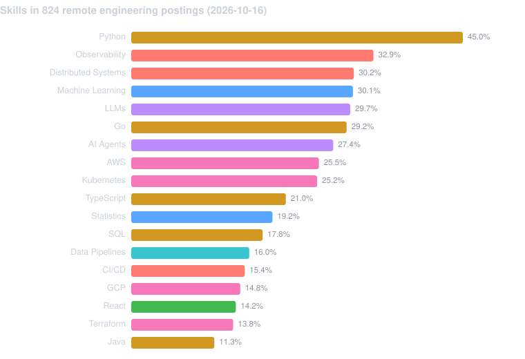
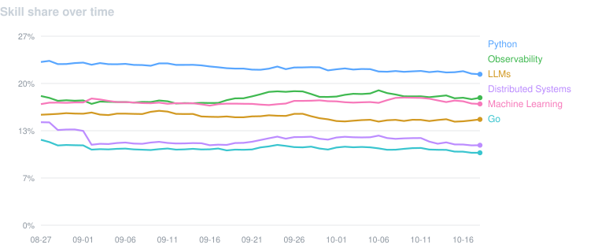
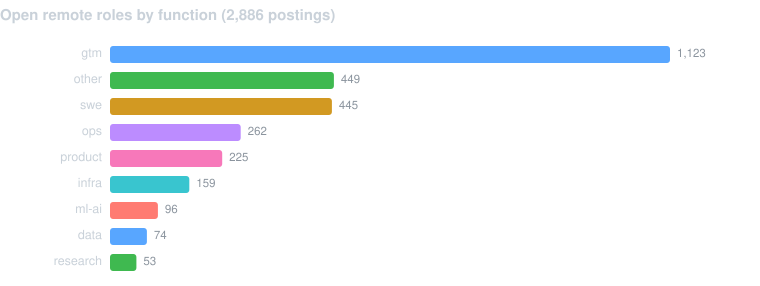
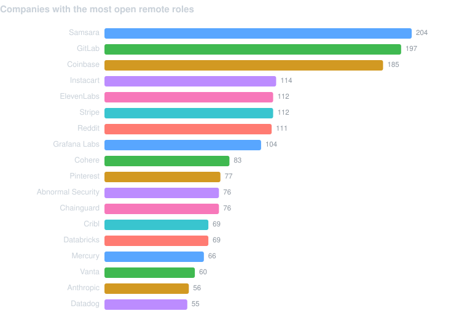

# AI Job Radar

> Daily snapshot of what AI and tech companies are hiring for in remote roles, built from public job-board APIs. Updated every morning by GitHub Actions.

**2026-10-12** — tracking **2,759 open remote roles** across **90 companies** (814 of them engineering roles). 1,636 postings disclose pay. **18 appeared today.**

<sub>Remote-only: 14,308 postings were collected across all locations and 19.3% of them were remote. Set `remote_only` to false in `config/settings.json` to track every location.</sub>

---

## Most-requested skills in remote engineering roles

Share of the 814 remote engineering postings that mention each skill.



<details><summary>Full skill table</summary>

| # | Skill | Category | Postings | Share |
|---:|---|---|---:|---:|
| 1 | Python | Languages | 364 | 44.7% |
| 2 | Observability | Practices | 270 | 33.2% |
| 3 | Distributed Systems | Practices | 258 | 31.7% |
| 4 | Go | Languages | 246 | 30.2% |
| 5 | Machine Learning | ML Fundamentals | 246 | 30.2% |
| 6 | LLMs | LLM & GenAI | 239 | 29.4% |
| 7 | AI Agents | LLM & GenAI | 222 | 27.3% |
| 8 | AWS | Infra & Cloud | 208 | 25.6% |
| 9 | Kubernetes | Infra & Cloud | 203 | 24.9% |
| 10 | TypeScript | Languages | 171 | 21.0% |
| 11 | Statistics | ML Fundamentals | 157 | 19.3% |
| 12 | SQL | Languages | 138 | 17.0% |
| 13 | CI/CD | Practices | 131 | 16.1% |
| 14 | GCP | Infra & Cloud | 125 | 15.4% |
| 15 | Data Pipelines | Data Engineering | 124 | 15.2% |
| 16 | React | Frameworks & Libraries | 119 | 14.6% |
| 17 | Terraform | Infra & Cloud | 113 | 13.9% |
| 18 | Java | Languages | 97 | 11.9% |
| 19 | Snowflake / BigQuery | Data Engineering | 71 | 8.7% |
| 20 | Airflow | Data Engineering | 70 | 8.6% |
| 21 | Azure | Infra & Cloud | 69 | 8.5% |
| 22 | Rust | Languages | 66 | 8.1% |
| 23 | Kafka | Data Engineering | 65 | 8.0% |
| 24 | Spark | Data Engineering | 60 | 7.4% |
| 25 | Docker | Infra & Cloud | 58 | 7.1% |
| 26 | Evals | LLM & GenAI | 53 | 6.5% |
| 27 | AI Safety | LLM & GenAI | 50 | 6.1% |
| 28 | Linux | Infra & Cloud | 50 | 6.1% |
| 29 | PyTorch | Frameworks & Libraries | 50 | 6.1% |
| 30 | Security | Practices | 47 | 5.8% |
| 31 | MCP | LLM & GenAI | 42 | 5.2% |
| 32 | Recommender Systems | ML Fundamentals | 41 | 5.0% |
| 33 | dbt | Data Engineering | 41 | 5.0% |
| 34 | Deep Learning | ML Fundamentals | 40 | 4.9% |
| 35 | MLOps | Practices | 38 | 4.7% |
| 36 | Databricks | Data Engineering | 37 | 4.5% |
| 37 | Multimodal | LLM & GenAI | 37 | 4.5% |
| 38 | RAG | LLM & GenAI | 35 | 4.3% |
| 39 | A/B Testing | Practices | 32 | 3.9% |
| 40 | GPU Clusters | Infra & Cloud | 32 | 3.9% |

</details>

## Movers

Change in share of postings since 2026-10-05, in percentage points.

| Rising | Δ pp | | Falling | Δ pp |
|---|---:|---|---|---:|
| Machine Learning | +0.47 | | Java | -0.78 |
| SQL | +0.44 | | Azure | -0.72 |
| TypeScript | +0.39 | | GCP | -0.67 |
| Kubernetes | +0.38 | | Kafka | -0.63 |
| Multimodal | +0.27 | | Distributed Systems | -0.62 |
| Docker | +0.24 | | Data Pipelines | -0.60 |
| Statistics | +0.23 | | AI Agents | -0.53 |
| Linux | +0.22 | | Observability | -0.52 |



## Where the roles are



| Role family | Postings | Share |
|---|---:|---:|
| gtm | 1,041 | 37.7% |
| swe | 443 | 16.1% |
| other | 424 | 15.4% |
| ops | 263 | 9.5% |
| product | 217 | 7.9% |
| infra | 151 | 5.5% |
| data | 84 | 3.0% |
| ml-ai | 82 | 3.0% |
| research | 54 | 2.0% |

## Disclosed pay, remote engineering roles

554 of 814 engineering postings (68%) publish a salary range. Figures are the midpoint of the posted band.

| Percentile | Midpoint |
|---|---:|
| 25th | $197,050 |
| Median | $227,735 |
| 75th | $260,000 |
| 90th | $287,500 |

<details><summary>Highest disclosed engineering bands by company</summary>

| Company | Top posted midpoint |
|---|---:|
| Anthropic | $675,000 |
| OpenAI | $455,500 |
| Pinterest | $371,087 |
| Reddit | $351,000 |
| Agility Robotics | $329,500 |
| Snorkel AI | $316,000 |
| Discord | $306,000 |
| GitLab | $301,800 |
| Pika | $292,500 |
| Vercel | $290,000 |

</details>

## Who is hiring most



---

## How this works

Every day at 08:00 UTC a GitHub Actions workflow queries the public job-board APIs of the companies in [`config/companies.json`](config/companies.json) — Greenhouse, Lever and Ashby all expose unauthenticated JSON endpoints. Each posting's description is scanned for the ~66 technologies defined in [`config/skills.json`](config/skills.json), then the description text is discarded and only the derived record is stored.

| Path | What it holds |
|---|---|
| `data/trends.csv` | One row per skill per day — the long-run time series |
| `data/seen.csv` | Every posting id and the date it first appeared |
| `data/snapshots/<week>.json.gz` | Full postings, archived weekly |
| `data/summary.json` | Aggregates for the latest run |
| `config/companies.json` | Tracked companies and their ATS slugs |
| `config/profile.json` | Your skills — drives the daily match issue |
| `config/settings.json` | `remote_only` and other pipeline switches |

### Adding a company

Job boards are keyed by an ATS slug that has to be discovered. Append `Name,slug-guess` lines to a text file and run the prober, which tries all three platforms and keeps whatever answers:

```bash
python src/probe_slugs.py candidates.txt > config/companies.json
```

### Caveats

- Skills are matched by keyword, so a description that merely mentions a technology counts the same as one that requires it.
- Company boilerplate repeated across most of a company's postings is stripped before matching; without that, an "About us" blurb would register as a skill on every role.
- Coverage is limited to companies using Greenhouse, Lever or Ashby. Firms on Workday and Taleo are absent, which skews toward startups and scale-ups.
- Counts include every posted location for a role, so widely-posted roles are represented more than once.
- Remote status comes from each board's own field where one exists and from the posted location otherwise. Ashby's `isRemote` is ignored because boards set it true on hybrid onsite roles; its `workplaceType` is used instead.


<sub>Generated 2026-10-12T17:19:46+00:00 · 4 board(s) unreachable this run</sub>
